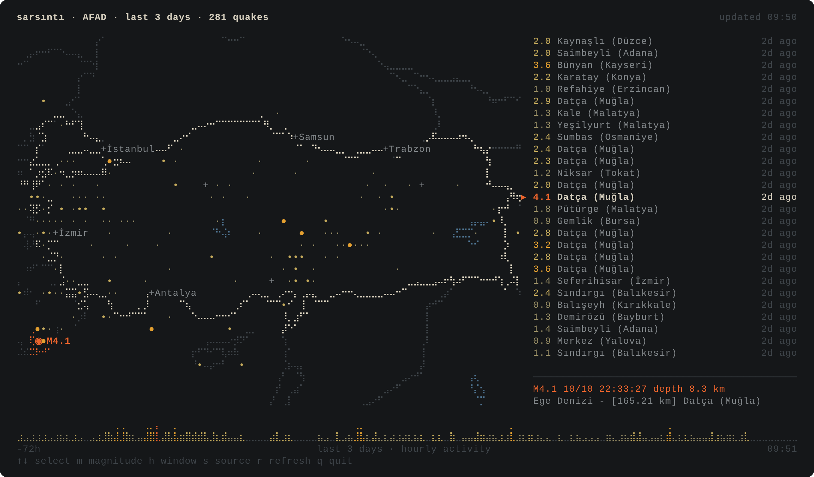

# sarsıntı

**Live earthquake map of Türkiye, drawn in your terminal.**

`sarsıntı` (Turkish for *tremor*) pulls the latest earthquakes from AFAD, Kandilli Observatory or USGS
and plots them on a braille-drawn map of Türkiye. It refreshes every minute, blinks new quakes, and runs a
seismograph strip of the whole time window along the bottom. Zero dependencies: just Node.



## Run it

```sh
npx github:HIMURAw/sarsinti
```

Or install it globally:

```sh
npm install -g github:HIMURAw/sarsinti
sarsinti
```

You need Node 18.17 or newer and a terminal font with braille characters. Most monospace fonts have them.

## What it does

| Command | |
| --- | --- |
| `sarsinti` | Live map with a list of recent quakes and a detail panel |
| `sarsinti list` | Print recent quakes and exit (`--json` for scripts) |
| `sarsinti watch` | Stream new quakes as they happen, with a desktop notification for each |
| `sarsinti snapshot` | Draw the map once, as ANSI text or `--svg file.svg` |

```sh
sarsinti --source kandilli --hours 72          # three days from Kandilli
sarsinti list --min 3 --near izmir             # M3+ quakes, with distance from İzmir
sarsinti list --min 2 --json | jq '.[0]'       # newest quake as JSON
sarsinti watch --min 4 --near ankara --radius 300
```

`watch` uses `notify-send` on Linux and Notification Center on macOS. It defaults to M4+ so it only
speaks up when it matters.

### Keys in the live map

| Key | |
| --- | --- |
| `↑` `↓` / `j` `k` | Move through the list; the selected quake is highlighted on the map |
| `PgUp` `PgDn`, `g` `G` | Jump |
| `m` | Minimum magnitude: all → 2 → 3 → 4 |
| `h` | Time window: 6 h → 24 h → 3 days → 7 days |
| `s` | Source: AFAD → Kandilli → USGS |
| `r` | Refresh now |
| `q` | Quit |

### Reading the map

| Mark | Magnitude |
| --- | --- |
| `·` | below 2 |
| `•` | 2 – 3 |
| `●` | 3 – 4 |
| `◉` + ring | 4 – 5. The ring grows with magnitude |
| `✱` + two rings | 5 and above |

Colours run from pale ochre to red as magnitude rises. A quake that arrived since the last refresh
blinks for a minute, and the terminal bell rings for anything M4 or larger.

## Data sources

| Source | Coverage | Notes |
| --- | --- | --- |
| [AFAD](https://deprem.afad.gov.tr) (default) | Türkiye and surroundings | Official disaster agency feed, reviewed solutions |
| [Kandilli](http://www.koeri.boun.edu.tr/scripts/lst0.asp) | Türkiye and surroundings | Boğaziçi University observatory, fast preliminary solutions |
| [USGS](https://earthquake.usgs.gov) | Global feed, clipped to the region | Fewer small events, useful as a cross-check |

Magnitudes come from each agency as published. Kandilli lists MD, ML and Mw; `sarsıntı` shows Mw when
present, otherwise ML, otherwise MD. **This is not an early-warning system.** For official information,
follow [AFAD](https://www.afad.gov.tr).

## How it works

- **Braille canvas.** Every terminal cell is a 2×4 grid of dots (Unicode U+2800–U+28FF), so a
  120-column terminal gives a 240-dot-wide canvas. Lines are rasterised into those dots, and each cell
  takes the colour of the most important layer drawn into it.
- **Projection.** Equirectangular, with longitude scaled by cos(latitude) so Anatolia keeps its proportions.
  The view grows along whichever axis has spare room, so the map always fills the frame.
- **Map data.** [Natural Earth](https://www.naturalearthdata.com) 1:50m coastlines, borders and lakes
  (public domain). `scripts/build-geo.mjs` clips them to the region, simplifies them with
  Douglas–Peucker, and bakes the result into `src/geo.js`. That file is about 24 KB.
- **One renderer, two outputs.** Each frame is a grid of cells that prints as ANSI escapes or saves as SVG.
  The screenshot above is `sarsinti snapshot --svg`.

```
src/
  sources.js   AFAD / Kandilli / USGS → one quake shape
  canvas.js    braille canvas
  view.js      map, list, detail panel, seismograph strip
  screen.js    cell grid → ANSI or SVG
  tui.js       live loop and keys
  cli.js       commands and flags
```

## Development

```sh
git clone https://github.com/HIMURAw/sarsinti && cd sarsinti
npm start            # live map
npm test             # node:test, no network
npm run screenshot   # regenerate docs/screenshot.svg
```

## Türkçe

`sarsıntı`, AFAD, Kandilli ve USGS'den son depremleri çekip terminalde braille karakterlerle çizilmiş bir
Türkiye haritasına işler. Dakikada bir yenilenir, yeni depremleri yanıp söndürür, M4 ve üstünde zil çalar.
Arayüz `$LANG` Türkçe ise Türkçe açılır; zorlamak için `--lang tr` verebilirsiniz.

```sh
npx github:HIMURAw/sarsinti
sarsinti list --min 3 --near ankara     # Ankara'ya uzaklıkla M3+ depremler
sarsinti watch --min 4                  # M4+ olunca masaüstü bildirimi
```

Resmî bilgi için her zaman [AFAD](https://www.afad.gov.tr)'ı takip edin.

## License

MIT © [Umut Öztürk](https://umutozturk.me)
